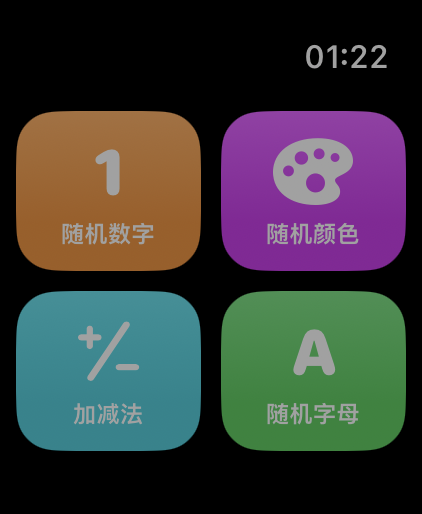
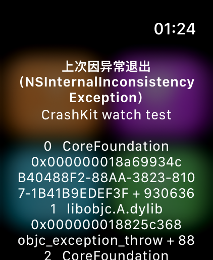
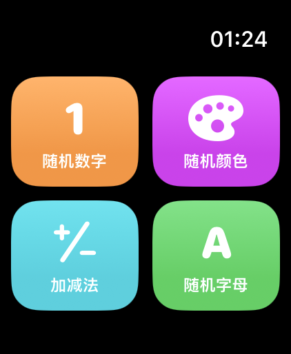
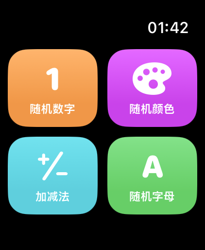
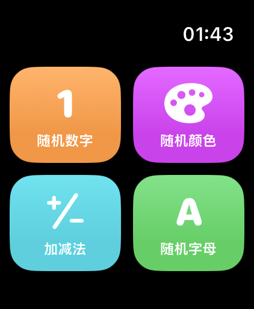

# CrashKit 0.1.1 × watchOS 真机接入测试报告

| 项目 | 值 |
|---|---|
| 测试时间 | 2026-10-26 00:57 – 01:25（Asia/Shanghai） |
| 工程 | `KidToys.xcodeproj` / target `KidToys Watch App`（watch-only） |
| Bundle ID | `me.zzhhoo.KidToys.watchkitapp` |
| 测试设备 | **Apple Watch Ultra 3**（`Watch7,12`），**watchOS 27.2**，Developer Mode `enabled` |
| 构建环境 | Xcode 27.0 / Swift 5 / 部署目标 watchOS 26.0 |
| 被测版本 | `0.0.3`（build `3`） |
| 被测依赖 | CrashKit **0.1.1**（remote，Exact Version） |

---

## 一、结论

> **2026-10-26 01:42 复查更新**：升级到 **CrashKit 0.1.2** 后，默认的 `install()` 在 watchOS 上已不会崩，
> 接入代码恢复成规格书原样。详见[第十一节](#十一复查升级-crashkit-012-之后2026-10-26-0142)。

**CrashKit 0.1.1 规格书给的那行 `CrashRecorder.shared.install()` 在 watchOS 真机上会让 App 一启动就死，且一个字节都写不出来。**

根因是平台限制：watchOS 禁止给致命信号挂处理器。`install()` 内部对 `SIGABRT` 等信号调 `signal()`，libsystem_c 立刻以
`sigaction on fatal signals is not supported` 抛 `EXC_BREAKPOINT / SIGTRAP`，进程当场终止。

因此：

- **信号路径（SIGABRT → 16 字节 → 「上次闪退（SIGABRT）」）在 watchOS 上不可能实现**，这与接入代码怎么写无关
- **异常路径（NSException）可用**：落盘 → 下次启动读取 → 弹窗 → 一次性消费，全链路已验证通过
- 最终交付的版本把 `install()` 改成 `install(options: .init(signals: []))`，只保留异常路径

---

## 二、九项结果

| # | 项目 | 结果 | 摘要 |
|---|---|---|---|
| 1 | 依赖 | ✅ | CrashKit `0.1.1`，`Package.resolved` 有 pin，revision `0c6a31c` |
| 2 | 构建 | ✅ | `BUILD SUCCEEDED`，无并发警告 |
| 3 | 安装 | ✅ | Ultra 3 / watchOS 27.2，自动签名 `App installed` |
| 4 | 崩溃 | ⚠️ | 原写法：启动即崩（SIGTRAP，非 SIGABRT）；`-crashkit-test` 真崩但记录 0 字节 |
| 5 | 重启 | ✅ | 弹窗为「上次因异常退出（NSInternalInconsistencyException）」，非「上次闪退（SIGABRT）」 |
| 6 | 二次启动 | ✅ | 不再弹 |
| 7 | 文件 | ❌ | `pending-signal.bin` 崩溃后仍是 **0 字节**（期望 16） |
| 8 | 改动 | ✅ | 4 个文件改动，**未 commit / tag / push** |
| 9 | 其它 | ⚠️ | 签名与包解析正常；手表息屏导致 devicectl 频繁超时 |

---

## 三、依赖

接入方式：remote package，`https://github.com/zhihaofans/CrashKit.git`，Dependency Rule = **Exact Version 0.1.1**。
只改 `project.pbxproj`，照 SwiftUtils 的四处结构复制（未手编重复 object id）：

| 位置 | 新增 |
|---|---|
| `PBXBuildFile` | `26D32452… /* CrashKit in Frameworks */` |
| `PBXFrameworksBuildPhase` | 引用上面那条 |
| `PBXNativeTarget.packageProductDependencies` | `26D32451… /* CrashKit */` |
| `PBXProject.packageReferences` | `26D32450… /* XCRemoteSwiftPackageReference "CrashKit" */` |
| `XCRemoteSwiftPackageReference` | `repositoryURL = ".../CrashKit.git"; kind = exactVersion; version = 0.1.1;` |
| `XCSwiftPackageProductDependency` | `productName = CrashKit;` |

`KidToys.xcodeproj/project.xcworkspace/xcshareddata/swiftpm/Package.resolved` 解析后：

```
crashkit    0.1.1   0c6a31cf7d9632aed7810c5f3627d2a02ff3bf15
                    https://github.com/zhihaofans/CrashKit.git
swiftutils  0.0.23  038f66632f2511e95b4b14272735f951b4ca3c69
alamofire   5.12.2  bda9ed57d72988a3a2ada33d824583541f86eac6
swift-log   1.16.1  4038b6a4f74a1426f47eb1dd5b4bb5628a15d597
```

> **坑**：`-packageCachePath` / `-clonedSourcePackagesDirPath` 传**相对路径**时 xcodebuild 认不到缓存，
> 直接报 `Missing package product 'SwiftUtils' / 'CrashKit'`。必须用绝对路径。

---

## 四、构建与安装

构建命令（真机 destination）：

```bash
WATCH=<Ultra 3 的 UDID>
xcodebuild -project KidToys.xcodeproj -scheme "KidToys Watch App" \
  -destination "platform=watchOS,id=$WATCH" -configuration Debug \
  -derivedDataPath "$PWD/.tmp/crashkit-dd" \
  -packageCachePath "$PWD/.tmp/crashkit-package-cache" \
  -clonedSourcePackagesDirPath "$PWD/.tmp/crashkit-source-packages" \
  -allowProvisioningUpdates build

xcrun devicectl device install app --device "$WATCH" \
  ".tmp/crashkit-dd/Build/Products/Debug-watchos/KidToys Watch App.app"
```

结果 `** BUILD SUCCEEDED **`。唯一 warning 与本次接入无关：

```
appintentsmetadataprocessor: warning: Metadata extraction skipped, no AppIntents.framework dependency found
```

签名：自动签名，`iOS Team Provisioning Profile: *`，无 provider 报错。
回读产物确认版本：

```
"CFBundleShortVersionString" => "0.0.3"
"CFBundleVersion"            => "3"
```

---

## 五、根因：watchOS 不允许挂致命信号处理器

按规格书写的 `CrashRecorder.shared.install()`，App **每次启动都崩**。从手表拉下来的 crash report（共 12 份）内容一致：

```json
"exception": {"type": "EXC_BREAKPOINT", "signal": "SIGTRAP",
              "codes": "0x0000000000000001, 0x000000018aa531a0"},
"termination": {"namespace": "SIGNAL", "indicator": "Trace/BPT trap: 5"},
"asi": {"libsystem_c.dylib": ["sigaction on fatal signals is not supported"]}
```

栈（对 `KidToys Watch App.debug.dylib` 用 `nm` 符号化）：

```
libsystem_c.dylib                              0x781a0
CrashKit.CrashRecorder.install(options:)  +0x82c   ← signal(SIGABRT, handler)
KidToys_Watch_AppApp.init()               +0x214
SwiftUI ...
```

`install()` 的执行顺序是：建目录 → `open(fd)`（于是 `pending-signal.bin` 被创建成 0 字节）→
`NSSetUncaughtExceptionHandler` → `for s in signals { signal(s, crashKitSignalHandler) }` ← **在这里被系统打死**。

所以文件永远停在 0 字节，`NSSetUncaughtExceptionHandler` 虽然装上了，`collect` 之后的内容一行都没机会跑。

**对照实验**：把调用改成 `install(options: .init(signals: []))` 后，App 正常启动、首页正常显示 ——
证明崩的就是「给致命信号装处理器」这一步，异常处理器本身没问题。



### 附带发现：`--console` 不能当崩溃证据

`devicectl ... --console` **不桥接 watchOS App 的 stdout**，全程无任何输出。
更关键的是我做了对照组：**不带任何启动参数**启动，同样打印

```
The app terminated with the exit code 0.
```

所以这行输出对「App 是不是崩了」没有鉴别力，只能靠 crash log 和落盘文件判断。

---

## 六、异常路径全链路（可用的那条）

### 1. 造异常并落盘

```bash
xcrun devicectl device process launch --device "$WATCH" --terminate-existing \
  me.zzhhoo.KidToys.watchkitapp -- -crashkit-exc-test
```

App 进程消失，`Library/Application Support/CrashKit/pending-exception.json` 落盘 **1073 字节**：

```
name    = NSInternalInconsistencyException
reason  = CrashKit watch test
stack   = 9 行（CoreFoundation → libobjc → KidToys init → SwiftUI → dyld）
```

### 2. 不重装、直接重启 → 弹窗

```bash
xcrun devicectl device process launch --device "$WATCH" --terminate-existing \
  me.zzhhoo.KidToys.watchkitapp
xcrun devicectl device capture screenshot --device "$WATCH" --destination alert.png
```



- **标题原文**：`上次因异常退出（NSInternalInconsistencyException）`
- **正文原文**：`CrashKit watch test` + 9 行堆栈
- 文件状态：`pending-exception.json` **被删除**（消费式，不是截断）

### 3. 二次启动不再弹



`HomeView.task` 里 `guard crashReport == nil` + `takePendingReport()` 一次性消费，符合预期。

---

## 七、文件字节数对照

| 时点 | 期望 | 实测 | 结论 |
|---|---|---|---|
| 崩溃后、读取前 `pending-signal.bin` | 16 字节 | **0 字节** | ❌ 信号记录写不出来 |
| 读取后 `pending-signal.bin` | 0 字节且文件仍存在 | 0 字节、仍存在 | ✅ 未被 unlink |
| 崩溃后 `pending-exception.json` | — | 1073 字节 | ✅ |
| 读取后 `pending-exception.json` | 已消费 | 文件消失 | ✅ |

`pending-signal.bin` 能正常从 `appDataContainer` 拉出来（不是权限问题），就是**没人往里写**。

---

## 八、代码改动

### `KidToys Watch App/KidToysApp.swift`

```swift
import Foundation
import SwiftUI
import SwiftUtils
import CrashKit

@main
struct KidToys_Watch_AppApp: App {
    init() {
        // signals 特意传空数组：watchOS 不允许给致命信号挂处理器，
        // 默认 install() 会以 "sigaction on fatal signals is not supported" 崩掉
        CrashRecorder.shared.install(options: .init(signals: []))
        SU.log.i("KidToys 启动")

        #if DEBUG
        let arguments = ProcessInfo.processInfo.arguments
        if arguments.contains("-crashkit-test") {
            CrashRecorder.shared.crashForTesting()
        }
        if arguments.contains("-crashkit-exc-test") {
            NSException(name: .internalInconsistencyException,
                        reason: "CrashKit watch test",
                        userInfo: nil).raise()
        }
        #endif
    }

    var body: some Scene {
        WindowGroup { HomeView() }
    }
}
```

### `KidToys Watch App/Home/HomeView.swift`

新增 `@State crashReport / showCrashAlert`，`NavigationStack` 之后挂 `.task` + `.alert`（与规格书一致）。

### 偏离规格书的地方（仅一处）

| 规格书 | 实际 | 原因 |
|---|---|---|
| `CrashRecorder.shared.install()` | `install(options: .init(signals: []))` | 不改就启动即崩（第五节） |

另外多加了 `-crashkit-exc-test` 分支，用于在手表上验证「落盘 → 读取」这条唯一可用的路径。
**CrashKit 源码一字未动**，`O_APPEND` / `loadUnaligned` / `ftruncate` 三条约束未被触碰。

改动清单（`git status`，**未 commit / tag / push**）：

```
 M "KidToys Watch App/Home/HomeView.swift"
 M "KidToys Watch App/KidToysApp.swift"
 M KidToys.xcodeproj/project.pbxproj
 M KidToys.xcodeproj/project.xcworkspace/xcshareddata/swiftpm/Package.resolved
```

---

## 九、其它发现与建议

### 1. 弹窗文案在手表上撑爆屏幕

正文直接用了 `report.details`，异常路径会塞进 9 行堆栈，42mm 屏幕上要滚动才能看完。
建议 watchOS 上自己拼短文案，例如只用 `report.title` + `reason` 一行，堆栈留给日志排查。

### 2. devicectl 反复超时（与本次接入无关）

手表一息屏就掉线，install / launch 常常报：

```
RemotePairingError error 1001：Timed out while attempting to establish tunnel
NWError 60 - Operation timed out
Navigation away from clock is not allowed due to one or more active system states
```

最后一条不是签名问题，把手表点亮后重试即可。建议验证期间保持屏幕常亮。

### 3. 真机截图能力（以后很有用）

```bash
xcrun devicectl device capture screenshot --device <UDID> --destination shot.png
```

真机 UI 验证不必再靠肉眼或猜，本条报告里的三张图都是这么来的。

### 4. 三条可选路线

1. **保持现状**（推荐）：watchOS 只走异常路径，够用
2. **回退接入**：撤掉依赖与代码，回到 0.0.2
3. **升 CrashKit 0.1.2**：库内用 `#if os(watchOS)` 自动跳过 `signal()`，让 `install()` 在手表上等价于 `signals: []`
   —— 要让「按规格书原样调用 `install()`」在手表上成立，只有这条路，但必须改库

---

## 十、复现步骤（精简版）

```bash
WATCH=$(xcrun devicectl list devices | grep '小天才' |
        sed -nE 's/.* ([0-9A-F]{8}-[0-9A-F]{16}) \(UDID\).*/\1/p' | head -1)
APP=me.zzhhoo.KidToys.watchkitapp

# 1) 编译安装（见第四节）
# 2) 造异常
xcrun devicectl device process launch --device "$WATCH" --terminate-existing "$APP" -- -crashkit-exc-test
# 3) 重启看弹窗
xcrun devicectl device process launch --device "$WATCH" --terminate-existing "$APP"
xcrun devicectl device capture screenshot --device "$WATCH" --destination alert.png
# 4) 再启动一次，确认不再弹
```

> 敏感信息说明：本报告不含设备 UDID、序列号或家庭成员姓名，设备一律以型号指代。

---

## 十一、复查：升级 CrashKit 0.1.2 之后（2026-10-26 01:42）

### 改了什么

- `project.pbxproj`：CrashKit 的 `exactVersion` 由 `0.1.1` → **`0.1.2`**
- `Package.resolved`：`crashkit 0.1.2`，revision `58877945489209c9cb625519876055f0ff355acd`
- `KidToysApp.swift`：**恢复成规格书原样**的 `CrashRecorder.shared.install()`（不再传 `signals: []`）

0.1.2 在 `install()` 里加了 `#if os(watchOS)` 分支：不调 `signal()`、不创建信号记录文件、
并把 0.1.1 在手表上留下的 0 字节 `pending-signal.bin` 直接 unlink 掉。
传入的 6 个默认信号会被清空，日志里会打一句「watchOS 不支持信号捕获，已忽略 signals=…」。

### 结果

| 检查项 | 结果 | 证据 |
|---|---|---|
| 启动不崩 | ✅ | 首页正常显示，01:41–01:43 期间**没有任何新的** KidToys 崩溃报告 |
| 残留清理 | ✅ | `Application Support/CrashKit/` 变成空目录，0 字节的 `pending-signal.bin` 已消失 |
| NSException 落盘 | ✅ | `pending-exception.json` **1073 字节**，`name=NSInternalInconsistencyException`、`reason=CrashKit watch test`、9 行堆栈 |
| 重启弹窗 | ✅ | 「上次因异常退出（NSInternalInconsistencyException）」 |
| 二次启动不再弹 | ✅ | 记录被消费，目录重新变空 |
| 信号路径 | ⚠️ | `-crashkit-test` 仍会真崩（crash log：`EXC_CRASH / SIGABRT`），但手表上**不记录、不弹窗** |






### 一个新的注意事项

`crashForTesting()` 在 watchOS 上是个**陷阱**：它照样 `raise(SIGABRT)` 把 App 打死，
但因为信号捕获在手表上被整体禁用，**不会留下任何记录、下次启动也不会弹窗**。
自测请改用 `-crashkit-exc-test`（造 `NSException`）那条路。

